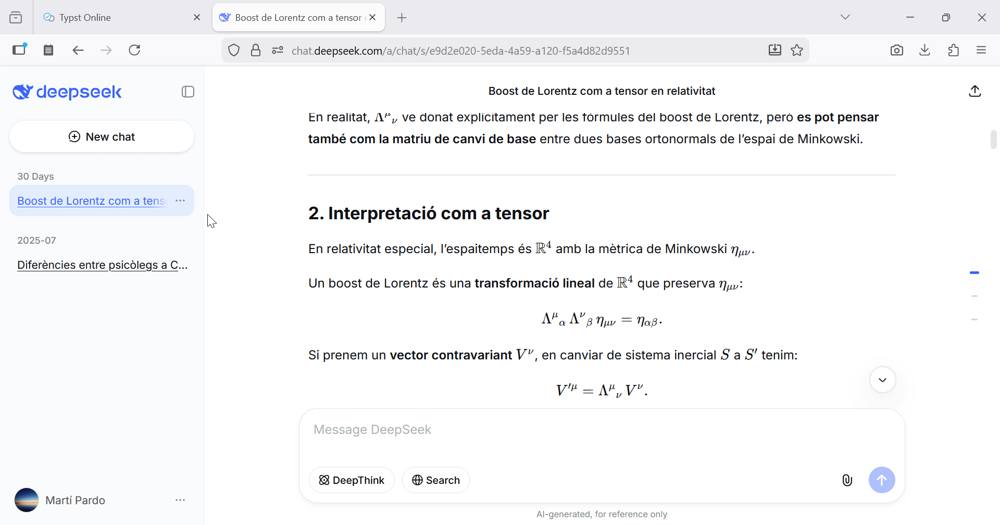
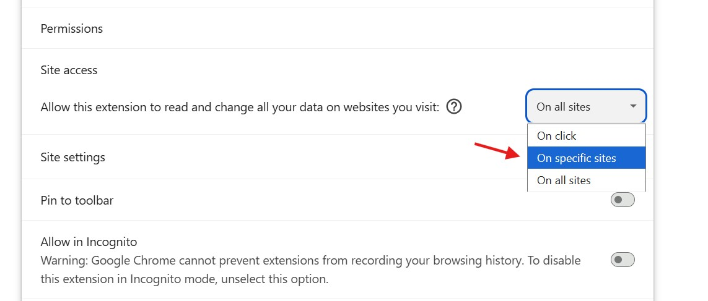
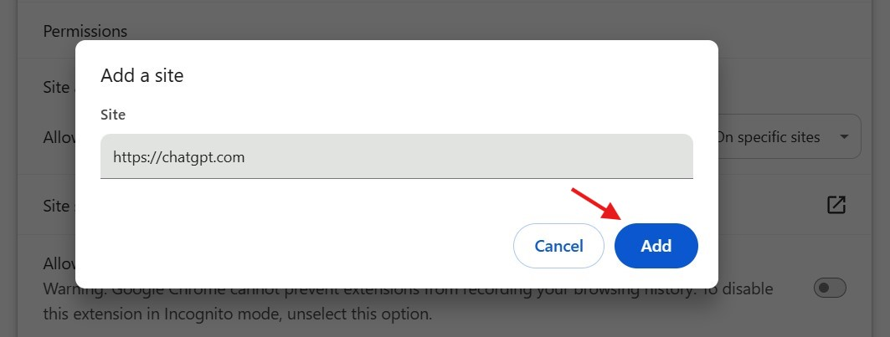

# CopyLaTeX

A Chrome (and [Firefox](#firefox-version)) extension that lets you quickly copy LaTeX code (KaTeX or MathJax) from equations displayed on websites like ChatGPT, DeepSeek, StackExchange, or any blog using mathematical equations.

Version 1.1: Now it also works with with Wikipedia and Wikiwand images.

Version 1.2: Now it also works for MathJax v3 (when there is no LaTeX code in the HTML) via API.

Version 1.3: Dark mode enabled and replaced check emoji with SVG icon.

Version 1.4: New feature! Select text (that includes formulas), right click on it and a `Copy as Markdown (with LaTeX)` option will appear.

Version 1.5: Now with Typst support!

Version 1.6: A new config button in the popup UI that allows some basic customization (like choosing the theme or hiding the 'copy as' feature in the context menu).

Version 1.7: New 'Show overlay on hover' setting (enabled by default), if disabled equations can be copied through a 'Copy equation' context-menu item.

## Example GIFs
#### KaTeX

#### MathJax

#### Wikipedia images

#### Copy as Markdown

You can use [https://markdown-preview-katex.vercel.app/](https://markdown-preview-katex.vercel.app/) to test this feature.

#### Copy as Typst

You can use [https://typst-online.vercel.app/](https://typst-online-editor.vercel.app/) to test this feature.

## Popular Sites Using MathJax/KaTeX
Generally any math, physics, or engineering-related blog or website. Some typical examples:
- KaTeX: ChatGPT, DeepSeek, Notion, Gemini...
- MathJax: Stack Exchange, ProofWiki...

## Host permissions and speed
You can check the javascript source code yourself. It loads after everything and is very fast and small sized. However if you want you can always customize in which hosts (websites) the extension loads or not:

This is done in `chrome://extensions` in the extension 'Details'.

Recommended websites to add

- https://chatgpt.com/*
- https://chat.deepseek.com/*
- https://math.stackexchange.com/*
- https://physics.stackexchange.com/*
- https://proofwiki.org/*
- https://\*.wikipedia.org/*
- https://www.wikiwand.com/*
- https://mathoverflow.net/*
- https://\*.notion.site/*
- https://publish.obsidian.md/*
- https://nbviewer.org/*
- https://gemini.google.com/*
- https://www.phind.com/*
- https://chat.mistral.ai/*
- https://librechat-librechat.hf.space/*
- https://www.perplexity.ai/*
- https://phys.libretexts.org/*

## Technical details

### Internal architecture

- `manifest.json` is the entry point of the extension, read about it [here](https://developer.mozilla.org/en-US/docs/Mozilla/Add-ons/WebExtensions/manifest.json).
- Inside `content/` we have our main content script (`main.js`) and other content scripts (output.js, detection.js, overlay.js, selection-to-markdown.js, selection-copy.js and utilities). As these scripts are classic scripts (not ES modules) each one is declared as an [IIFE](https://developer.mozilla.org/en-US/docs/Glossary/IIFE) function (`(() => {})();`) so that all variables and functions of the script are scoped, this way we can use the same names in each script (like `const ns` or `detectMathElement()`). They communicate with each other
through the [`window`](https://developer.mozilla.org/en-US/docs/Web/API/Window) API (using the `window.CopyLatex` object), each one exposing a little API to the others.

  - `overlay.js` simply contains the logic and position of the overlay when hovering over an equation.
  - `detection-registry.js` lists the supported math renderers and each site-specific detection strategies. This is the script that contains the actual detection and it's therefore the one that is gonna be updated more regularly.
  - `detection.js` runs those strategies to locate math in the DOM and extract the LaTeX code (both for hover and for selection)
  - `selection-to-markdown.js` reads the (live) selection, clones it, replaces equations with LaTeX markers, and converts the result to Markdown. This conversion is synchronous so `output.js` can set clipboard data during the actual copy event.
  - `selection-copy.js` listens for Ctrl+C/Cmd+C when the setting is enabled and sends the copy event to `output.js`.
  - `output.js` reads (the LaTeX code or selection already converted to Markdown), converts it to Typst when selected, and copies it to clipboard. For keyboard copy, it sets `clipboardData` during the (native) copy event.

      Note: The browser APIs and clipboard operations are `async` because they are beyond permissions of content scripts (which are tab specific), these are browser-wide (the copied latex in one tab need to be pasteable to other tabs). The keyboard selection-copy is the only exception to this (it sets `clipboardData` synchronously because it reads the native copy event).
  - `main.js` receives hover and click events, uses `detection.js` API to see if it's math or not and then calls the `overlay.js` and `output.js` APIs.

      For MathJax v3/v4, the main script also injects `mathjax-bridge.js` into the
      page to be able to use the MathJax API. The bridge obtains the LaTeX and sends it back to the content script using `window.postMessage`.
- `popup.js` has the logic and settings of the popup UI. It reads and writes the prefered settings to the local storage (`browser.storage.local`).
- `background.js` runs within the extension context (whole browser, not a page script, not a content script), it reads local storage to see if preferences have changed and act on it (for example hide the context menu option), read more about it [here](https://developer.mozilla.org/en-US/docs/Mozilla/Add-ons/WebExtensions/Background_scripts).

    For selection conversion from the context menu it sends a message to `output.js` of the tab, and then it's the content script which inspects the (live) selection, converts it and copies it to the clipboard.

- Javascript libraries (inside `lib/`) load
later as globals, these are [turndown](https://github.com/mixmark-io/turndown), [tex2typst](https://github.com/qwinsi/tex2typst) and [markdown2typst](https://github.com/Mapaor/markdown2typst).

### How to test the extension locally

1. Download the `src` directory (using for example [download-directory.github.io](https://download-directory.github.io/)). Rename it if you want.
2. Then go to `chrome://extensions` (as if it were an URL) and in the top left click the 'Load unpacked' button and select the `src` (or whatever is named now) folder.

## Links
- Chrome Add-on page: [https://chromewebstore.google.com/detail/copy-latex-katex-mathjax/lmhdbdfaadjfjclobmodomehekpjpkgn](https://chromewebstore.google.com/detail/copy-latex-katex-mathjax/lmhdbdfaadjfjclobmodomehekpjpkgn)
- GitHub Repo: [https://github.com/Mapaor/copy-latex-chrome-extension](https://github.com/Mapaor/copy-latex-chrome-extension)
- README as a website: [https://mapaor.github.io/copy-latex-chrome-extension/](https://mapaor.github.io/copy-latex-chrome-extension/)

## Firefox version
There is also a Firefox version of this extension: [https://github.com/Mapaor/copy-latex-fireofx-extension](https://github.com/Mapaor/copy-latex-firefox-extension) 

You can also use this extension in Brave and Arc (they support Chrome extensions by default). 

I also plan to adapt this code for Edge and Opera and publish in their respective places. 

A Safari version is not planned because publishing in Safari is ridiculously expensive.

## Acknowledgements

Credits to @leander-ow for his dark mode contribution and to @ashigirl96 for suggesting and providing a working code implementation for the copy selection as Markdown feature, and to @deralbert for his ChatGPT custom rendering fix.

This extension also works thanks to the following open source projects:
- [Turndown](https://github.com/mixmark-io/turndown) - Library for converting HTML to Markdown
- [tex2typst](https://github.com/qwinsi/tex2typst) - Library for converting LaTeX to Typst
- [markdown2typst](https://github.com/Mapaor/markdown2typst) - Library for converting Markdown to Typst
- [webextension-polyfill](https://github.com/mozilla/webextension-polyfill/) - Library for using the Promise-based browser API in Chrome

## License

[MIT License](/LICENSE)

It is MIT Licensed so that anyone can customize it to their needs but please don't just copy-cat the code and publish it with a new name, it's weird. 

If you have an idea for a new feature open an issue and let me know! Also if you have the time to implement a feature you want it would be great if you made a pull request.

## Roadmap
### To-do minor improvements or fixes
Some minor things to fix or improve (for when I have the time):
- [X] In the copy selection (both to Markdown and to Typst) feature fix the Wikipedia case (don't detect images that contain the `mwe-math` related classes as images).
- [X] Add support for new ChatGPT custom table rendering
- [X] Fix new google search math rendering 
- [ ] Fix overlay overflow in very large pages

### Internal improvements
- [X] Unify detection for single equations and for equations in range of a selection into a single one
- [X] Rewrite detection.js so that there is a single registry containing all detection specific rules for each kind of math rendering (to make it easier to add new kinds of math rendering of specific websites)
- [ ] Improve the documentation of the extension (the screenshots and GIFs are of previous versions). 
- [ ] Maybe even create a website for the extension using another repo and GH pages.
- [ ] Create a set of single-file html files that serve to test the extension for all the different math kinds (kinds defined in detection.js).

### Planned features:
- [X] **Text selection to Markdown**: Select some text that includes equations, right click and a new option "[Extension Icon] Copy as Markdown" appears.
- [X] **Typst support**: 
  Pop up with a toggle between LaTeX and Typst
- [X] **Theme selection**: Config option to choose the theme (light, dark or system)
- [X] **Hide option in context menu**:  Allow users to hide the copy selection feature when right-clicking (for those who don't need it and want a less clustered context menu).
- [X] **Hide overlay option**: Allow to hide the hover overlay and use the right-click 'Copy equation' menu item instead.
- [X] **Hijack Ctrl+C for selection**: Option to copy selection (as Markdown or Typst) without having to open the context menu.
- [ ] **Choose the bulleted list marker**: Option to choose between * or - for markdown unordered lists.
- [ ] **Custom  delimiters**: 
Config option to chose between no delimiters (default), `$` and `$$`, `\(` and `\[`, always `$`, or always `$$`.
- [ ] **Custom translations**. Allow to replace the 'Click to copy', 'Copied!', 'Copy as Markdown' and 'Copy as Typst' messages to be replaced by custom ones.
